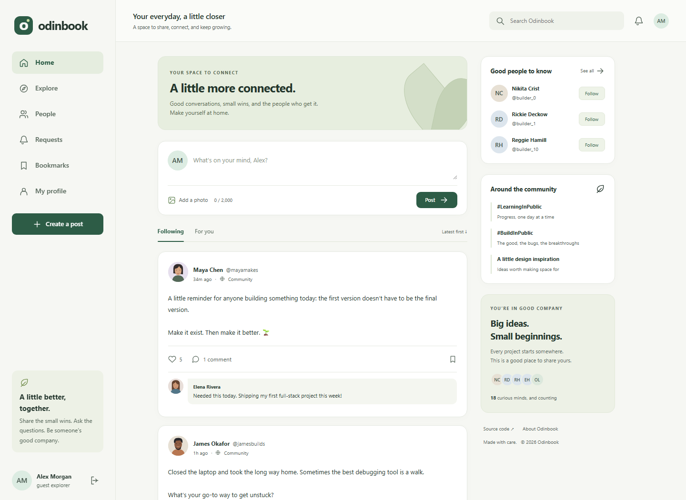

# Odinbook

**Good people. Small moments. A little more connected.**

A full-stack social network by [Miguel Rua](https://github.com/MiguelRcol), built for [The Odin Project's Odin Book assignment](https://www.theodinproject.com/lessons/nodejs-odin-book). Express and Passport handle authenticated requests; Prisma and PostgreSQL store the social graph, posts, interactions, and cookie sessions. A responsive vanilla JavaScript client keeps the interface focused on the conversation.

[Try the portfolio sandbox](https://miguelrcol.github.io/odinbook/) · [API reference](docs/api.md) · [Architecture](docs/architecture.md) · [Deployment guide](docs/deployment.md)



> **Two distinct ways to try the project:** the full implementation runs on Express + PostgreSQL. The GitHub Pages link is a clearly labeled browser-only sandbox with local storage and simulated accounts. It does not host the backend or satisfy the assignment's live backend deployment requirement. A Render Blueprint is included for deploying the real application.

## Features

- Sign up and sign in with Passport Local, or explore with an isolated guest profile.
- Send, cancel, accept, and decline follow requests. Only accepted follows appear in the home feed.
- Share text and HTTPS image posts with accessible image descriptions.
- Like, comment, and bookmark; remove your own posts and comments.
- Create and update a profile, biography, location, website, and profile picture.
- Browse people, search conversations or members, and explore the community.
- Paginate feeds and comments without loading the entire database.
- Use a responsive interface with mobile navigation, keyboard focus, semantic forms, and accessible dialogs.

## Run locally

Requires Node.js **22.12+** and npm; Node 24 LTS is recommended. Local PostgreSQL binaries are provided through the development dependency `embedded-postgres`, so you don't need Docker or an existing database installation.

```bash
git clone https://github.com/MiguelRcol/odinbook.git
cd odinbook
npm ci
npm run setup
npm run dev
```

Open **http://localhost:3020** and choose **Explore as a guest**. Setup creates a random session secret, applies checked-in migrations, and seeds example conversations and 18 profiles without overwriting your data. The UTF-8 PostgreSQL database is persisted in ignored `data/postgres-utf8/`; the development launcher binds it to `127.0.0.1:55432` and stops it when you stop the app.

To try request approval with two browser sessions locally, sign in as these sample members:

| Member       | Email                   | Password            |
| ------------ | ----------------------- | ------------------- |
| Maya Chen    | mayamakes@example.com   | BuildSomething2026! |
| James Okafor | jamesbuilds@example.com | BuildSomething2026! |

Sample sign-in is disabled for newly seeded production databases. Use guest access or create a real account in production.

For an existing PostgreSQL instance, copy `.env.example` to `.env`, set `DATABASE_URL` and a random `SESSION_SECRET` of at least 32 characters, and run `npm run setup`. Leave `LOCAL_POSTGRES` unset so the launcher uses your database. Existing databases must use UTF-8.

## Verify

```bash
npm run check
npm test
npx playwright install chromium
npm run test:ui
npm audit --audit-level=high
```

The 20 integration tests use a separate, temporary PostgreSQL instance. They cover authentication, session rotation, CSRF, follow approval, feed access, concurrent likes, bookmark privacy, validation, search, pagination, ownership, guest isolation, and relational integrity. Set `TEST_DATABASE_URL` to a dedicated database to use an existing test instance; **never point it at a production database**. Tests migrate that database and add fixtures, but do not reset it.

Browser tests exercise the guest journey, post interactions, profile persistence, mobile navigation, search, and axe accessibility checks. GitHub Actions runs these checks against a PostgreSQL service. Browser tests require the local setup or a configured external development database; they create guest fixtures in that database.

## Stack and decisions

| Layer        | Choice                                           | Reason                                                         |
| ------------ | ------------------------------------------------ | -------------------------------------------------------------- |
| Server       | Express 5, ESM JavaScript                        | Builds directly on the assignment's Node.js curriculum         |
| Identity     | Passport Local, scrypt, PostgreSQL session store | Server-side, revocable sessions; no browser-stored auth tokens |
| Database     | PostgreSQL 17, Prisma 7 with `adapter-pg`        | Explicit relationships, migrations, constraints, and indexes   |
| Client       | HTML, CSS, JavaScript modules                    | A small client with no framework runtime or build dependency   |
| Validation   | Zod, database CHECK constraints                  | Friendly input errors and an integrity backstop                |
| Verification | Node test runner, Supertest, Playwright, axe     | Real API and browser behavior rather than mocked persistence   |
| Hosting      | Render Blueprint; Docker option                  | Express and PostgreSQL deployed together                       |

No chat, push notifications, email verification, password reset, file uploads, or OAuth is claimed. The Requests screen represents follow requests; there is no general notification system. Image URLs are supported, with a documented production tradeoff in the architecture notes.

## Project layout

```text
src/                Express API, Passport configuration, password hashing, database lifecycle
prisma/             Schema, migrations, relational and session constraints
public/             Responsive client, original SVG artwork, optional sandbox adapter
scripts/            Local PostgreSQL launcher, setup, checks, build, guest cleanup
tests/              Real PostgreSQL integration tests and browser tests
docs/               Architecture, API, deployment, walkthrough, screenshots
seeds.js            Deterministic curated content plus Faker community profiles
render.yaml         Full-stack hosting Blueprint
Dockerfile          Production container
compose.yaml        Local Docker alternative
```

## Portfolio walkthrough

1. Enter as a guest; notice that the home feed contains your accepted follows.
2. Create a post, like a conversation, add a comment, and save a bookmark.
3. Explore people and send a follow request. In a second browser session, accept that request from the target account to demonstrate the social graph.
4. Update your profile and reload; changes survive because they are persisted in PostgreSQL.
5. Explain how unique composite keys make concurrent likes safe, and how ownership checks prevent another member from deleting your contributions.

[A longer project walkthrough and interview talking points](docs/portfolio.md) explain the implementation and limitations. Artwork is original SVG source included in the repository; no third-party images or paid services are required. MIT licensed.
