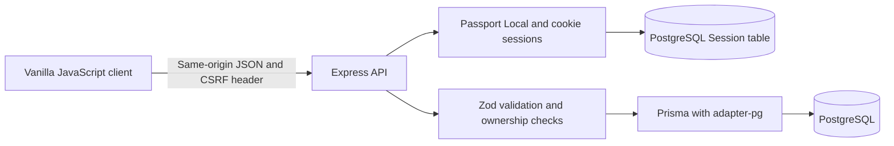
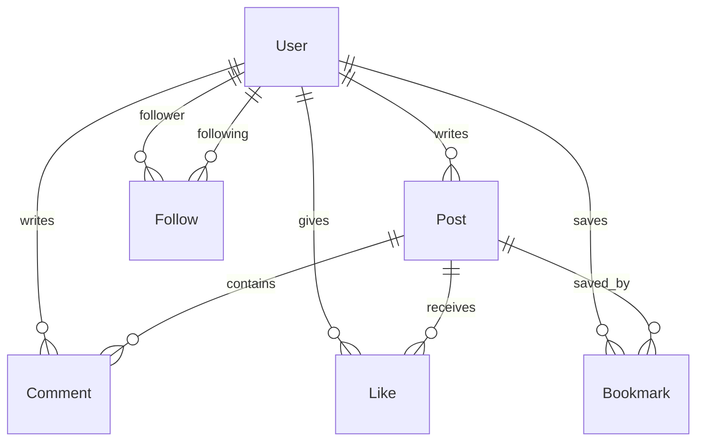

# Architecture and data model

## Request lifecycle

Express serves the static client and the JSON API from one origin. The initial session endpoint returns only the current identity, guest availability, and a CSRF token. All community APIs require authentication. The publicly served HTML is the sign-in shell, with no embedded user or post records; protected data is fetched only after sign-in.

Passport stores the user ID in a PostgreSQL-backed session, with an HttpOnly, SameSite=Lax cookie and a seven-day expiry. Production enables Secure cookies and trusts one reverse proxy. Registering, signing in, and entering as a guest regenerate the session and rotate the CSRF token. Every non-read API request must present that token; configured origins are checked as an additional layer. Logout destroys the session. Passwords use Node's scrypt with individual random salts and constant-time verification.

## Relational model

`Follow(followerId, followingId)` is a directed edge. Its composite key prevents duplicate requests. It begins as `PENDING`; only the recipient can change it to `ACCEPTED` or decline it. Removing an edge cancels a pending request or unfollows an accepted connection. Database checks reject self-following.

`Like(userId, postId)` and `Bookmark(userId, postId)` have composite primary keys. PUT creates the relation with `INSERT ... ON CONFLICT DO NOTHING` through Prisma `createMany({ skipDuplicates: true })`. DELETE removes only the acting member's relation. Repeated or simultaneous PUTs succeed without generating duplicate counts. Bookmarks are private to the acting member.

Foreign keys cascade on user, post, and comment lifecycle boundaries. Deleting a post also removes its comments, likes, and bookmarks. Text length and nonempty content are enforced in both Zod and PostgreSQL CHECK constraints. A separate SQL migration owns the session table and integrity checks; Prisma owns the social schema.

## Feed semantics

The home feed is the current user's posts plus posts whose author has an **accepted** incoming edge from the current user. Pending requests never enter the home feed. Explore shows the community's posts to authenticated members. Profiles show the selected author's posts. Bookmarks show the current member's saved posts.

The feed is sorted by `createdAt DESC, id DESC`, with 12 posts per page and an ID cursor. Profile and author chronology indexes support common feed queries. Post relation indexes support counts. Every post carries its public author, like and comment counts, current-user interaction flags, and its two most recent comments; the comment endpoint returns the full conversation in pages of 30. Counts and interaction flags come from the database rather than client guesses.

## Client and sandbox

The client escapes all text inserted into markup and permits only HTTPS external image or website URLs. It checks stale navigation responses before applying page results. Loading placeholders, empty states, input constraints, errors, and toasts make changes understandable. Dialogs use native focus management; reduced-motion preferences and keyboard focus are supported.

`config.js` chooses between the real same-origin API and the browser-only `demo.js` adapter. The sandbox uses an independent `odinbook-portfolio-v1` local storage key, displays its limitations persistently, and does not send credentials or changes to a backend. Its simulation is only for showcasing the interface. **The backend is never replaced with local storage in the real application.**

## Scope and operational limits

- Guests get individual database accounts and initial accepted follows to seeded builders. Directory listings omit guests. Run `node scripts/cleanup-guests.js` daily against the intended database to remove guest accounts older than seven days and their dependent content; scheduling is not automatically provisioned.
- Image URLs and avatar URLs are stored, not binary uploads. External image providers receive a visitor's request and can remove or change those images. There is no server-side URL fetch and thus no server-side image-fetch SSRF path. For a production service, add owned media storage and a vetted upload pipeline.
- The portfolio app has no password recovery, email verification, moderation dashboard, reporting flow, blocking, OAuth, direct messaging, live chat, or real-time transport. Those are intentional extension points rather than completed capabilities.
- Rate limiting is in-process, suitable for a single portfolio instance. Multiple instances need a shared rate-limit store. PostgreSQL sessions themselves are shared.
- `trust proxy = 1` assumes a single trusted proxy in front of Express; adjust it to the actual topology before changing hosts.
- Feed cursor deletion can produce an empty next page; clients can refresh. At larger scale, a compound time-and-ID cursor, relationship pagination, and query-plan profiling would be appropriate.
- Database backups, observability, abuse response, retention policy, and provider lifecycle management remain operator responsibilities for a public production social network.
